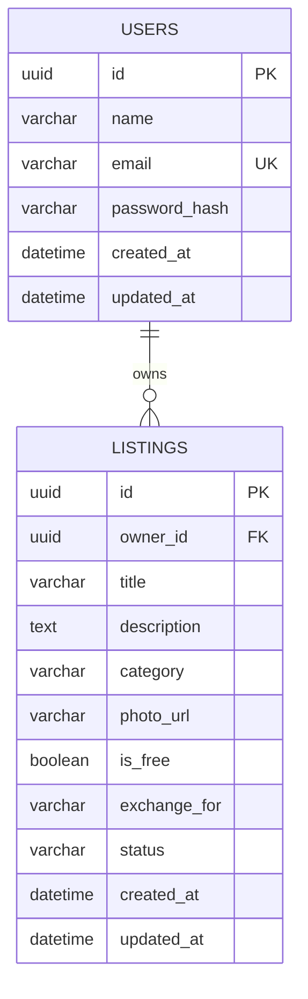

# Initial database schema

The migration at
`backend/src/database/migrations/1731600000000-InitialSchema.ts` is the source
of truth. It runs automatically when the NestJS API starts outside tests.

## Constraints

- `users.email` is normalized to lower case by the API and has a unique index.
- Deleting a user cascades to listings owned by that user.
- Listing status is limited to `AVAILABLE`, `RESERVED`, or `EXCHANGED`.
- `password_hash` contains a bcrypt hash and is excluded from normal entity
  queries. There is no plaintext-password column.

The listing table is introduced now so later sprints can add listing use cases
without replacing the initial schema. Sprint 1 does not expose listing create,
edit, request, or moderation endpoints.
